# Store Manager API


🇧🇷 [Leia em português](./README.pt-br.md)

REST API for a store management system: products and sales, backed by **MySQL**, documented with **Swagger**, covered by automated tests and runnable with **Docker**. Built to solidify backend fundamentals during Trybe's Full Stack Web Development course.

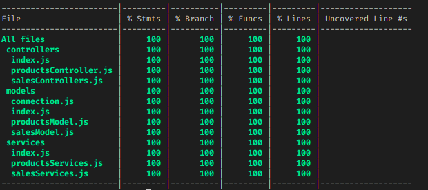

## Features

- CRUD for **products** and **sales**, plus product search by name
- Layered architecture: **Model → Service → Controller**, written in a functional style
- Relational database (MySQL) with migration and seed scripts
- Interactive API documentation with Swagger at `/api-docs`
- Security basics: Helmet, rate limiting, centralized error handling and environment variables
- Unit tests for every layer (models, services, controllers) with Mocha, Chai, Sinon and nyc, aiming at full coverage
- Docker and Docker Compose setup, Husky and ESLint for code quality

## Tech stack


Also: Chai, Sinon, nyc, Helmet, express-rate-limit, express-rescue and dotenv.

## Running locally

Clone the repository and create a `.env` file in the project root.

```bash
git clone https://github.com/IgorMarinhoArgollo/store-manager.git
cd store-manager
```

### Option 1: Docker (recommended)

Requirements: Docker and Docker Compose.

```env
MYSQL_HOST=db
MYSQL_USER=admin
MYSQL_PASSWORD=123
MYSQL_DATABASE=StoreManager
PORT=3000
DB_PORT=3308
```

```bash
docker-compose up
```

When the terminal shows the message below, the containers are ready:

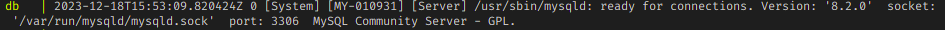

### Option 2: Node.js and a local MySQL

Requirements: Node.js and MySQL.

```env
MYSQL_HOST=localhost
MYSQL_USER=root
MYSQL_PASSWORD=12345678
MYSQL_DATABASE=StoreManager
PORT=3000
```

```bash
npm install
npm run migration   # creates the database
npm run seed        # populates it
npm run dev         # starts the API
```

Open the Swagger docs at <http://localhost:3000/api-docs>.

## API

| Method | Route | Description |
|---|---|---|
| GET | `/products` | Lists all products |
| GET | `/products/:id` | Gets a product |
| GET | `/products/search?q=` | Searches products by name |
| POST | `/products` | Creates a product |
| PUT | `/products/:id` | Updates a product |
| DELETE | `/products/:id` | Deletes a product |
| GET | `/sales` | Lists all sales |
| GET | `/sales/:id` | Gets a sale |
| POST | `/sales` | Creates a sale |
| PUT | `/sales/:id` | Updates a sale |
| DELETE | `/sales/:id` | Deletes a sale |

<details>
<summary>Request examples (screenshots)</summary>

**Products**

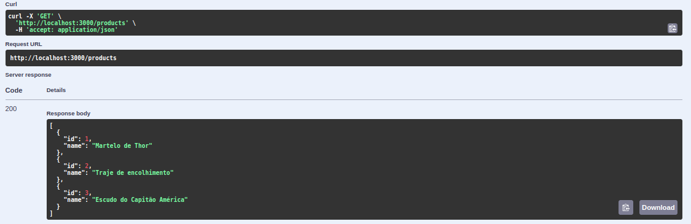
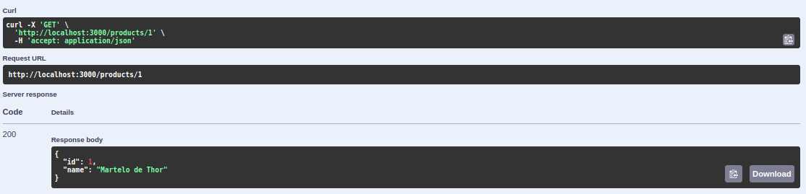
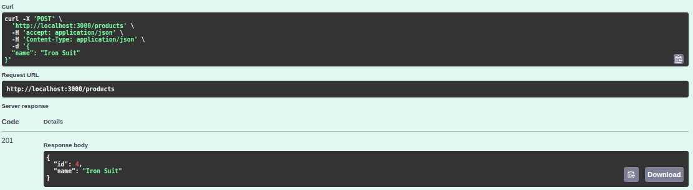
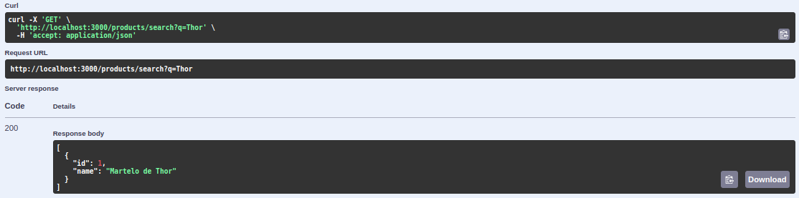
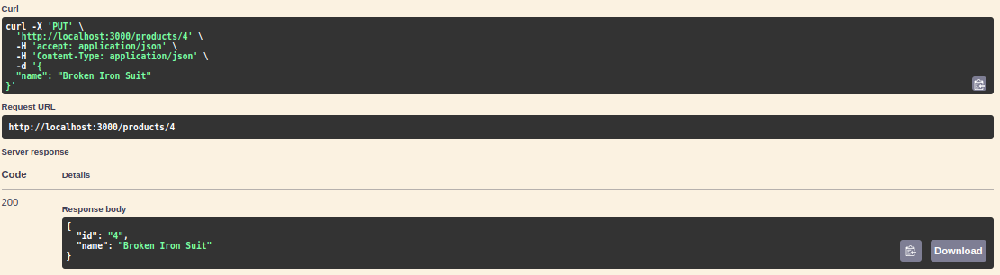
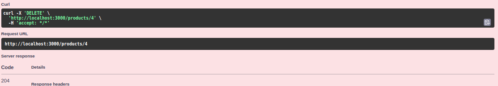

**Sales**

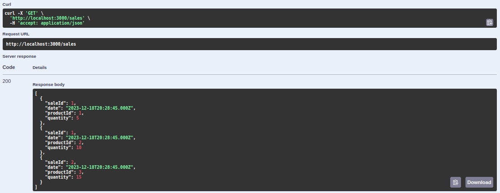
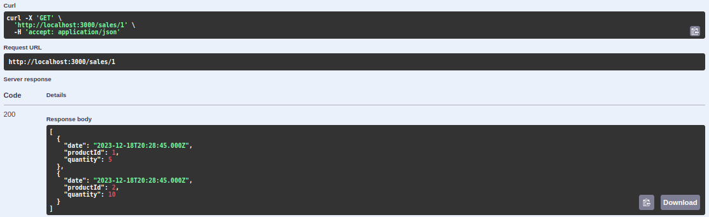
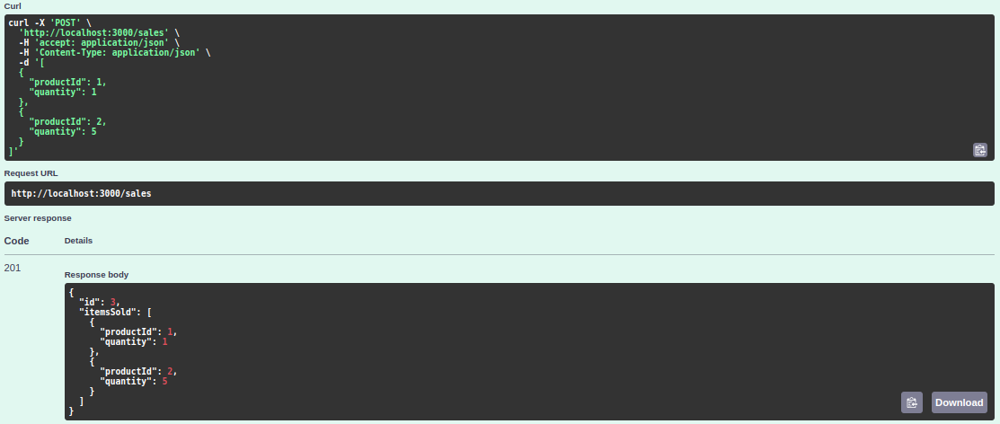
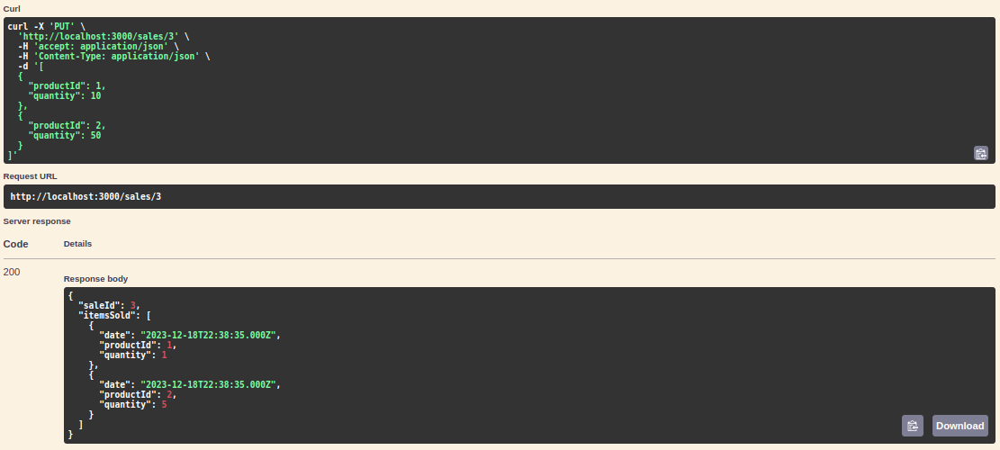
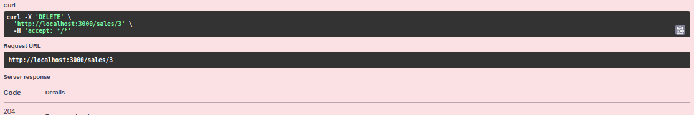

</details>

## Tests

```bash
npm test
```

The test suite mirrors the architecture, with one folder each for models, services and controllers under `tests/`.

## Author

**Igor Marinho Argollo** · [LinkedIn](https://www.linkedin.com/in/igormarinhoargollo/) · [Portfolio](https://igor-marinho.netlify.app/)

## License

MIT
