# Store Manager API


🇺🇸 [Read in English](./README.md)

API REST de gerenciamento de loja: produtos e vendas, com banco **MySQL**, documentação em **Swagger**, testes automatizados e execução com **Docker**. Foi desenvolvida para solidificar os fundamentos de backend durante o curso de Desenvolvimento Web Full Stack da Trybe.

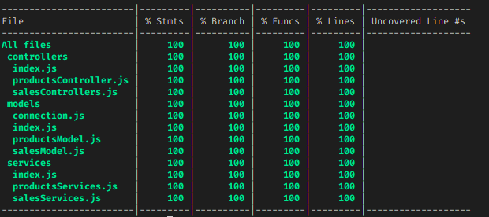

## Funcionalidades

- CRUD de **produtos** e **vendas**, com busca de produtos por nome
- Arquitetura em camadas **Model → Service → Controller**, em estilo funcional
- Banco de dados relacional (MySQL) com scripts de migration e seed
- Documentação interativa da API com Swagger em `/api-docs`
- Boas práticas de segurança: Helmet, rate limit, tratamento centralizado de erros e variáveis de ambiente
- Testes unitários de todas as camadas (models, services e controllers) com Mocha, Chai, Sinon e nyc, buscando cobertura total
- Configuração com Docker e Docker Compose, Husky e ESLint para qualidade de código

## Tecnologias


Também: Chai, Sinon, nyc, Helmet, express-rate-limit, express-rescue e dotenv.

## Como rodar

Clone o repositório e crie um arquivo `.env` na raiz do projeto.

```bash
git clone https://github.com/IgorMarinhoArgollo/store-manager.git
cd store-manager
```

### Opção 1: Docker (recomendada)

Requisitos: Docker e Docker Compose.

```env
MYSQL_HOST=db
MYSQL_USER=admin
MYSQL_PASSWORD=123
MYSQL_DATABASE=StoreManager
PORT=3000
DB_PORT=3308
```

```bash
docker-compose up
```

Quando o terminal exibir a mensagem abaixo, os contêineres estarão prontos:

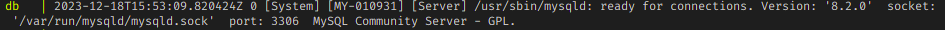

### Opção 2: Node.js e MySQL local

Requisitos: Node.js e MySQL.

```env
MYSQL_HOST=localhost
MYSQL_USER=root
MYSQL_PASSWORD=12345678
MYSQL_DATABASE=StoreManager
PORT=3000
```

```bash
npm install
npm run migration   # cria o banco de dados
npm run seed        # popula o banco
npm run dev         # inicia a API
```

Abra a documentação Swagger em <http://localhost:3000/api-docs>.

## API

| Método | Rota | Descrição |
|---|---|---|
| GET | `/products` | Lista todos os produtos |
| GET | `/products/:id` | Busca um produto |
| GET | `/products/search?q=` | Busca produtos por nome |
| POST | `/products` | Cria um produto |
| PUT | `/products/:id` | Atualiza um produto |
| DELETE | `/products/:id` | Remove um produto |
| GET | `/sales` | Lista todas as vendas |
| GET | `/sales/:id` | Busca uma venda |
| POST | `/sales` | Cria uma venda |
| PUT | `/sales/:id` | Atualiza uma venda |
| DELETE | `/sales/:id` | Remove uma venda |

<details>
<summary>Exemplos de requisições (capturas de tela)</summary>

**Produtos**

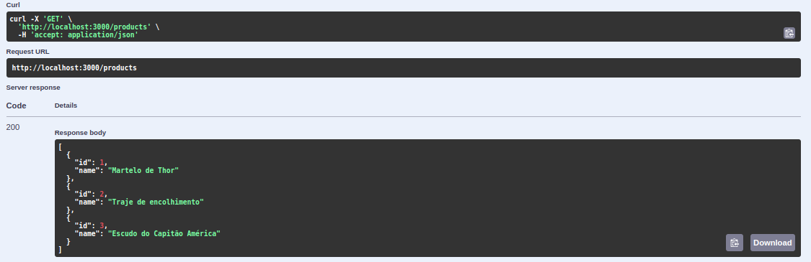
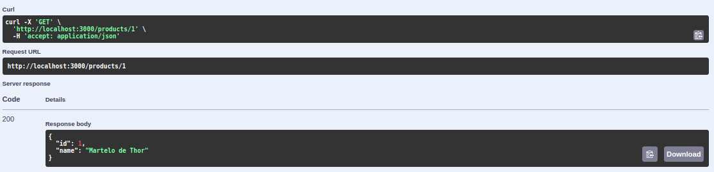
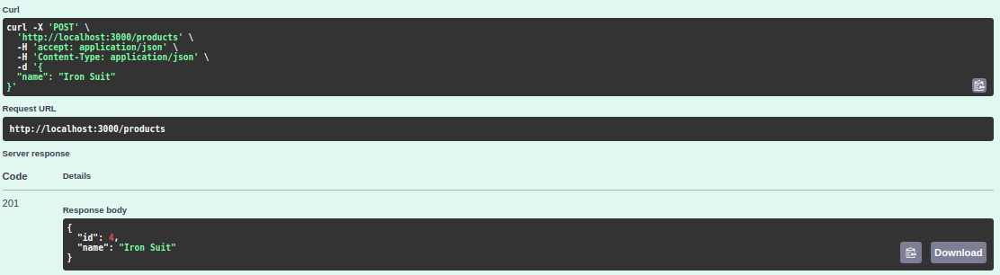
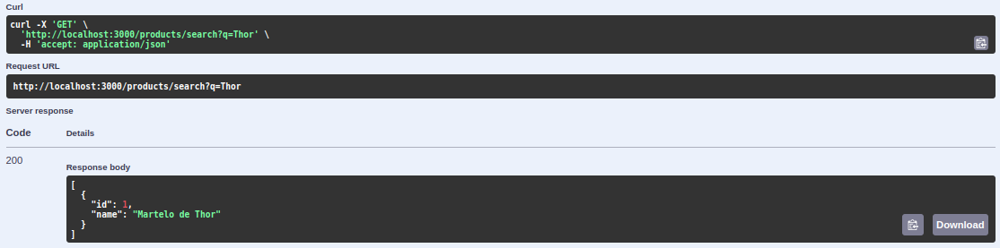
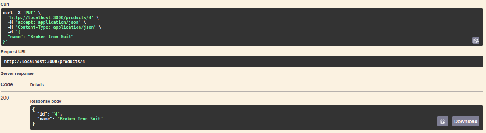
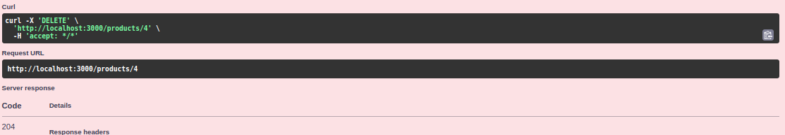

**Vendas**

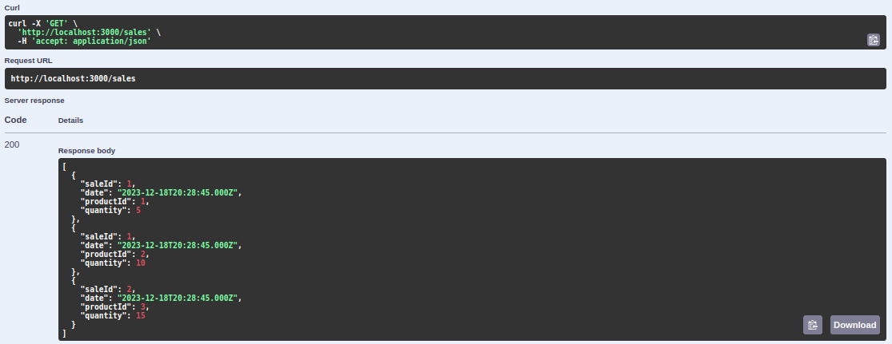
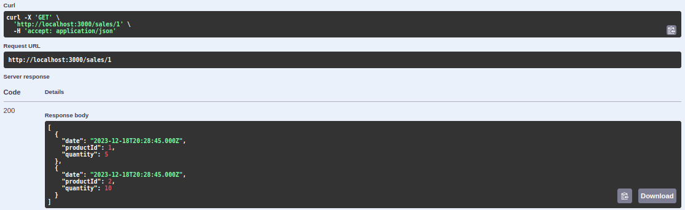
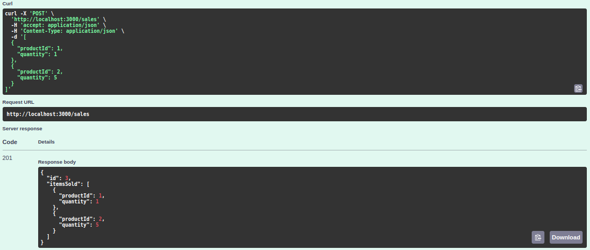
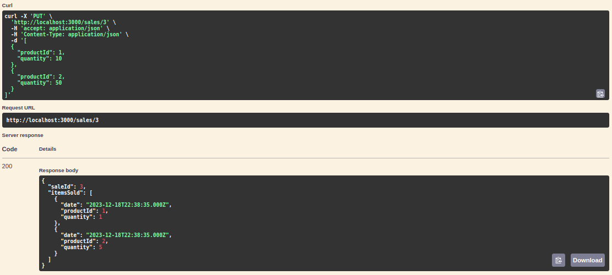
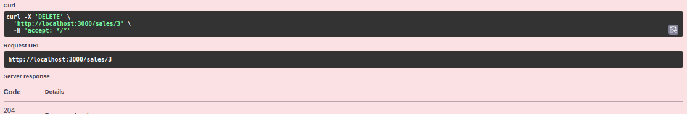

</details>

## Testes

```bash
npm test
```

A suíte de testes espelha a arquitetura, com uma pasta para models, services e controllers dentro de `tests/`.

## Autor

**Igor Marinho Argollo** · [LinkedIn](https://www.linkedin.com/in/igormarinhoargollo/) · [Portfólio](https://igor-marinho.netlify.app/)

## Licença

MIT
